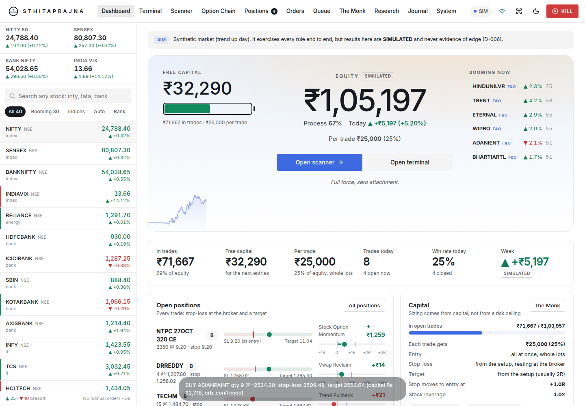
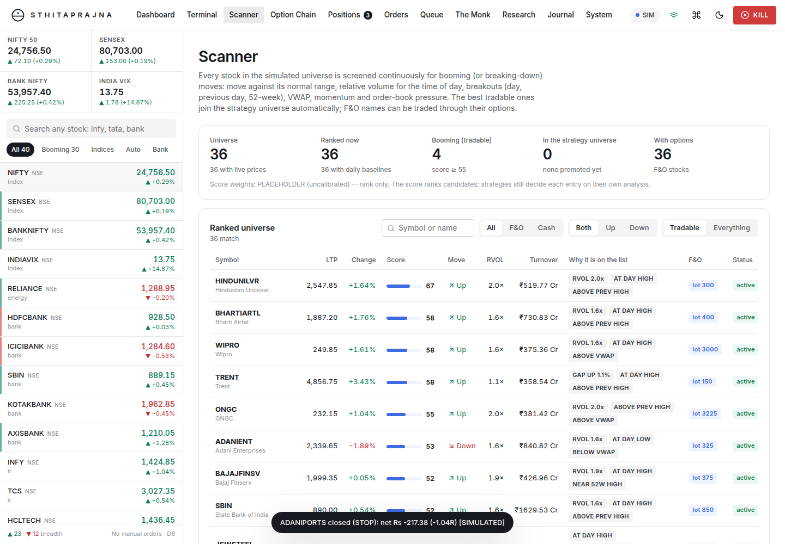
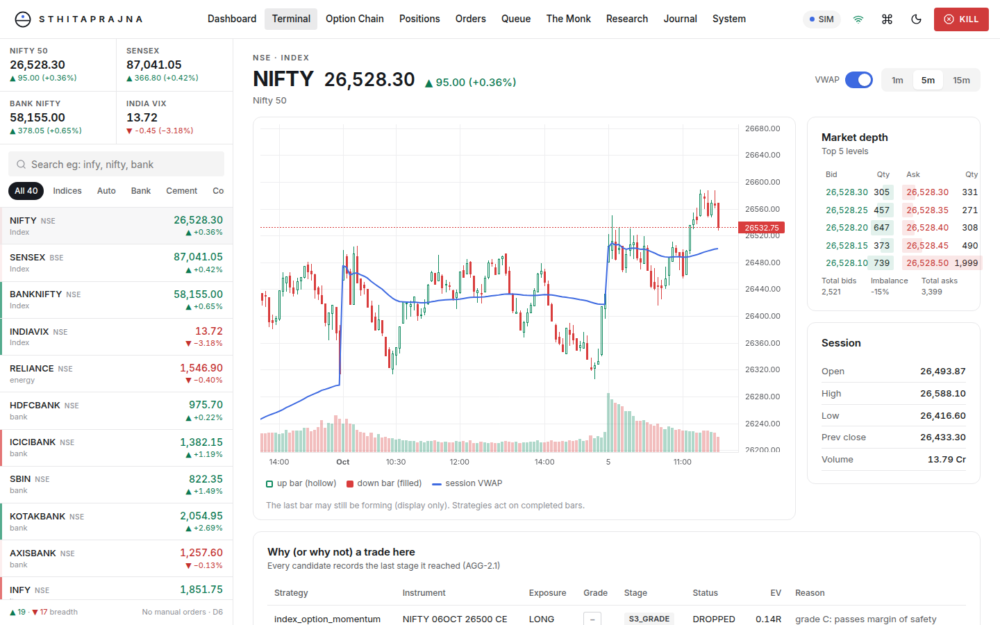
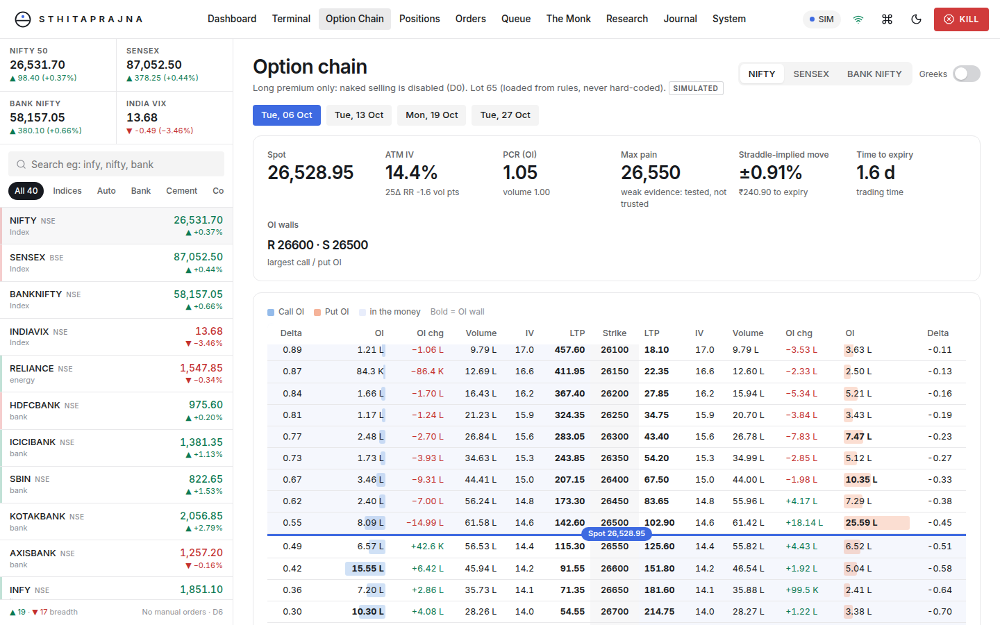
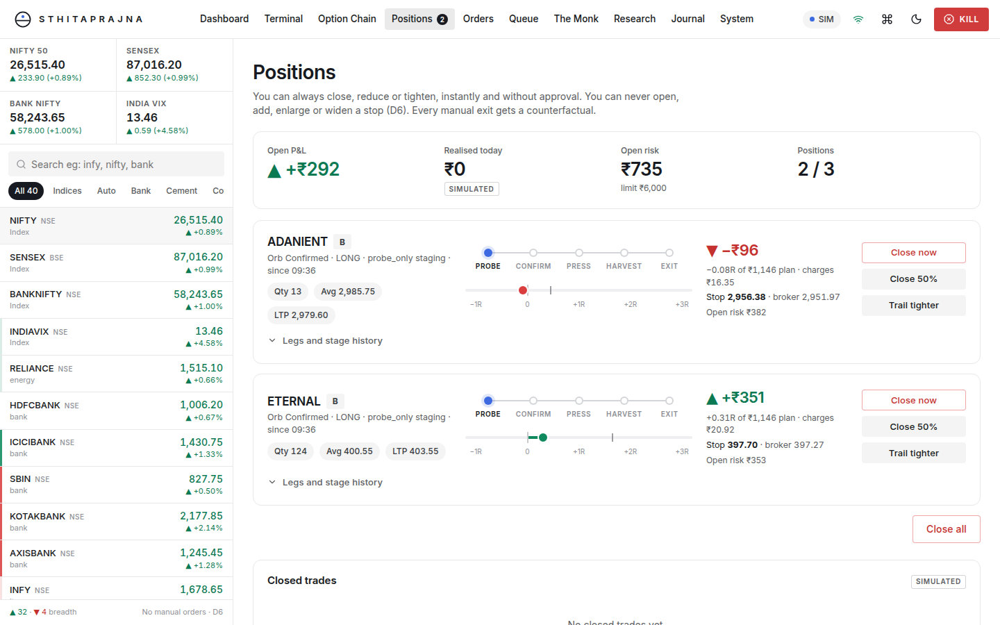
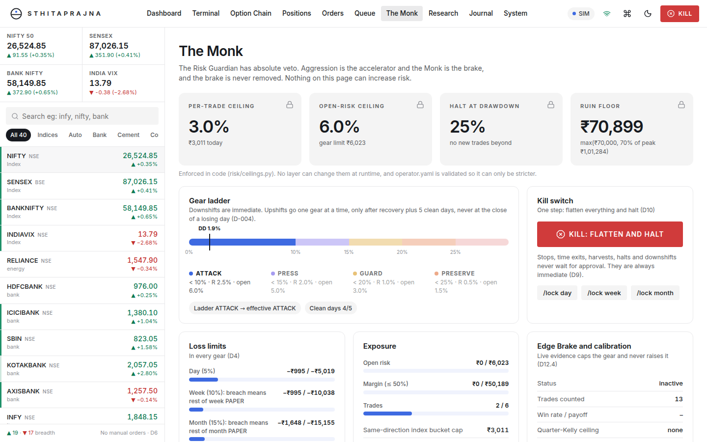
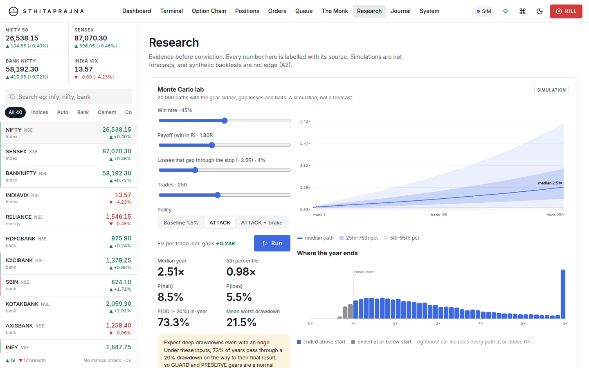
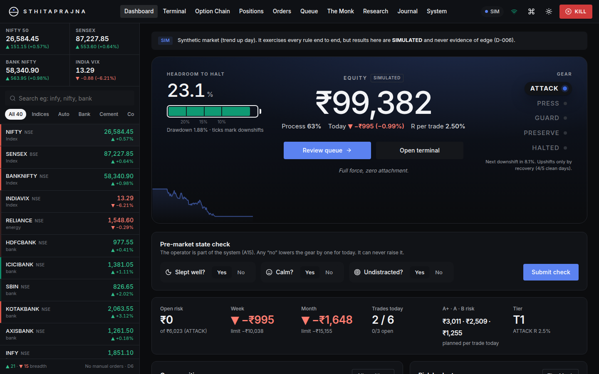

# Sthitaprajna 2.0: Options Hero

**Aggressive by design, bounded by code, honest by contract.** A pure **index and stock options** trading system
for Indian markets (NSE/BSE), forked from Sthitaprajna v3.0 and narrowed to options only. Dhan handles execution
and primary data, Upstox is the secondary data feed. It ships as a Tesla-inspired web terminal (watchlist, charts,
option chain, positions, orders), but it has **no Buy button**. The system proposes, the Risk Guardian ("The Monk")
vetoes, and you approve, close, reduce or halt (spec D6).

> **Not a guaranteed-return system.** Out of the box it runs on a **built-in synthetic market (SIM)**, so every
> trade and P&L you see is labelled **SIMULATED**. It proves the rules, costs and safety mechanics work end to end --
> it is not evidence of edge. With your Dhan data credentials it runs **PAPER on live Dhan market data** (simulated
> fills, labelled PAPER, dummy `PAPER-ALGO-0000` tag). A live Dhan broker is built and tested against a fake API;
> going LIVE needs your real Dhan trading credentials **and** a deliberate opt-in
> (`STHITAPRAJNA_LIVE_TRADING_CONFIRMED=yes`) -- see [`docs/LIVE_TRADING.md`](docs/LIVE_TRADING.md) before you touch it.
>
> **Risk mode.** `config/operator.yaml` currently defaults to `risk_mode: unbounded` (D-049, 5 Oct 2026, reversing
> the earlier `bounded` default): capital-based sizing, one full entry with a stop-loss and a target, no
> gears/ceilings/loss-limits/staging/approvals -- `unbounded.capital_per_trade` at 25% of equity per trade. Unbounded
> mode also skips the mandatory operator-approval-per-entry gate on LIVE orders, not only the risk ceilings.
> `risk_mode: bounded` (5.0% planned risk per trade, 10.0% open-risk ceiling, gears
> ATTACK→PRESS→GUARD→PRESERVE→HALTED, a Zero-to-Hero sleeve with its own budget and cumulative-loss kill switch) is
> still one YAML line away if you want the bounded stance instead -- [`docs/decisions.md`](docs/decisions.md) D-037
> and D-049 explain the trade-off either way.

## Run it (one minute)

```bash
python -m pip install -e ".[dev]"      # Python 3.11+
sthitaprajna serve                      # opens the terminal on http://127.0.0.1:8788 (SIM mode, 30x speed)
```

Different port on purpose (`8788`, not v1's `8787`) so both can run side by side on the same machine. The web UI is
pre-built into the Python package, so Node is only needed if you change the UI (`cd web && npm ci && npm run build`).

Settings and credentials go in a `.env` file (copy `.env.example`). `sthitaprajna` reads it automatically from the
folder you start it in. **Live market data (paper trading):** put `DHAN_CLIENT_ID` and `DHAN_DATA_TOKEN` in `.env`,
run `sthitaprajna dhan-check`, then `sthitaprajna serve --mode paper` (guide: [`docs/PAPER_LIVE_DATA.md`](docs/PAPER_LIVE_DATA.md)).
**Going live for real:** [`docs/LIVE_TRADING.md`](docs/LIVE_TRADING.md) -- short version, `DHAN_TRADING_TOKEN` +
`sthitaprajna order-check` + `STHITAPRAJNA_LIVE_TRADING_CONFIRMED=yes` + `serve --mode live`.
**Discord alerts and approvals (optional):** follow [`docs/DISCORD_SETUP.md`](docs/DISCORD_SETUP.md),
then `pip install -e ".[dev,discord]"` and `sthitaprajna serve --discord`.

| Command | What it does |
|---|---|
| `sthitaprajna serve [--speed 60] [--seed 7] [--discord]` | Engine + terminal (SIM). Refuses to bind beyond localhost without `STHITAPRAJNA_API_TOKEN` |
| `sthitaprajna serve --mode paper [--discord]` | Same engine on **live Dhan data** with simulated fills (PAPER); real clock, Upstox optional |
| `sthitaprajna serve --mode live [--discord]` | **Real orders** on your Dhan account. Gated: needs `DHAN_TRADING_TOKEN` + `STHITAPRAJNA_LIVE_TRADING_CONFIRMED=yes` |
| `sthitaprajna dhan-check` | Read-only check of your Dhan **data** access: ids, quotes, history, option chain (prints no secrets) |
| `sthitaprajna order-check [--place-test-order]` | Read-only Dhan **order** readiness check; optionally proves the order path with one tiny real order |
| `sthitaprajna backtest --days 10 --compare-staging` | Same engine in fast-forward: staged vs single entry (SIMULATED) |
| `sthitaprajna mc --reproduce-d12` | Reproduces the master prompt's D12.1 Monte Carlo table exactly |
| `sthitaprajna rules` | Market-rules freshness audit (every rule carries its source and verification date) |
| `sthitaprajna feasibility` | Phase 0 table: what fits ₹1 lakh at ATTACK gear |

## What's inside

| Layer | Highlights |
|---|---|
| **Strategies** (options-only) | `IndexOptionMomentum` (Nifty/Sensex/Bank Nifty OR breaks with OI confirmation), `ZeroToHero` (the expiry-afternoon convex sleeve, D8 -- EV-compared across three delta bands, not one fixed strike), `StockOptionMomentum` (booming F&O stocks via their options), `IndexRangeReversion` (D-041 -- fades range extremes back to the mean when the other strategies' trend/expiry setups aren't there, confirmed by a reversal candlestick, RSI and OI), `DayRangeBreakout` (D-043 -- a later second-leg break of the day's own high/low once that level has already carried past the opening range, on index and scanner-promoted stocks alike), `ScalpMomentum` (D-048 -- a short 1-3 minute directional burst traded on its own, in any regime except EXTREME_VOL including RANGE, tight stop/target and a higher-delta near-ATM strike so a small move actually moves the option) |
| **Pattern recognition** (D-041) | `market/patterns.py`: bullish/bearish engulfing, hammer, shooting star, doji, and a range-compression-then-expansion breakout detector -- feeds the strategies above as an extra Confirmation, not a standalone signal |
| **Scanner** | Every NSE stock in Dhan's master screened continuously for booming (or breaking-down) moves: move against ATR, relative volume for the time of day, breakouts (day, previous day, 52 weeks), VWAP, momentum and order-book pressure. Only F&O-eligible names ever get traded, through their options |
| **Option chain analytics** | Greeks (delta/gamma/theta/vega, Black-76 on the forward), OI walls, PCR (OI + volume), max pain, ATM straddle-implied move, 25-delta risk reversal skew, **OI build-up classification** (long/short build-up, short covering, long unwinding), **IV rank/percentile** against a persisted history, **IV − realized-vol spread**, **expiry-day pin-risk proxy** |
| **Aggression Layer** (AGG-1/2, bounded mode) | Gear controller (ATTACK→PRESS→GUARD→PRESERVE→HALTED), Edge Brake (quarter-Kelly cap), A+/A/B conviction sizing, lot-granularity skips, staged pickup funnel S1–S7, and staging (probe → confirm-add → press → harvest → trail) that never adds to a loser -- including two earlier profit-lock tiers below the +2R harvest threshold (D-042: breakeven at +0.5R, a partial lock at +1.0R), firing even earlier on a position's own expiry day (D-045: 0.3R/0.6R -- extrinsic value decays fastest into the close), and a reversal watch (D-045) that adds one extra confirmation, never a forced flip, when a fresh independently-confirmed candidate sits opposite a recent stop-out on the same underlying |
| **Risk Guardian** | 30+ named checks with absolute veto: 5% per trade, 10% open risk, 28% halt, ruin floor, day/week/month limits, profit give-back, streak cooldowns, correlation buckets (Nifty+Sensex = one bet), margin caps, the Zero-to-Hero sleeve budget and its cumulative-loss kill switch, targets that never change risk |
| **Data** | **Live Dhan data for PAPER** (quotes with depth, 1-minute bars built from quotes, 5-session backfill, option chains, rate limited, errors that name the fix), Dhan and Upstox read-only adapters, A5.5 feed arbitration table, data-quality guardian, and a realistic SIM market (regimes, gaps, VIX, Black-76 option chains with OI walls) with **failure injection**. Realized P&L and the all-time peak survive a process restart (D-047), replayed from the SQLite store |
| **Unbounded mode** (D-031) | Capital-based sizing, one full entry with stop-loss and target, no gears/ceilings/staging/approvals -- but still capped at one bet per underlying+direction per deploy cycle (D-046), so several strategies agreeing on the same move in one cycle can't each independently commit a full capital slice to what is really one correlated bet |
| **Execution** | Order state machine, Algo-ID tagging (dummy in PAPER/SIM, real in LIVE), OPS cap below SEBI's 10/s, freeze-qty slicing, broker-side stops that fire even when your feeds or order API are down, gap-through-stop fills. **Live Dhan broker**, gated behind explicit credentials + confirmation: stop-first exits (nothing can sell twice), marketable limits for options, reconciliation with Dhan's positions, capital capped by Dhan's funds, approval required on every entry by default |
| **Research** | Monte Carlo that matches D12.1 digit for digit, Target-to-Plan (says `PROBABILITY UNKNOWN` until validated data exists), a backtester on the identical code path, Indian charges model with Budget 2026 STT |
| **Terminal** | Dashboard, TradingView candles + depth, option chain (now with build-up/IV-rank/pin-risk panels), positions with stage stepper and manual close/close-50%/trail-tighter, orders, queue with full decision trail, The Monk, research lab, journal, system/failure injection. Light (default) and dark themes; phone layout |
| **Operator channel** | Approvals with a 60 s countdown (timeout = skip), command palette (`Ctrl K`, `/status`, `/target month 8%`, `/lock`, `/kill`), an optional Discord bot with the same whitelist, and an editable Part D risk panel on the Monk page (D-044 -- staging/limits/sleeve, validated against the hard ceilings, restart to apply), none of which can increase risk past those ceilings |

## Screens

The terminal shares its UI foundation with v1 (same Tesla-inspired light/dark terminal, same view set); these
screenshots predate 2.0's options-only copy and Chain-view analytics additions, so treat them as representative of
the shell, not a pixel-exact preview.

| | |
|---|---|
|  |  |
|  |  |
|  |  |
|  |  |

## Tests

```bash
pytest                                  # 226 tests: property tests (bounded + unbounded), scanner, options
                                         # analytics, Zero-to-Hero (EV bands + D8 kill switch), range reversion,
                                         # day-range breakout, scalp momentum, pattern recognition, staging
                                         # profit-lock tiers (including expiry-day decay tiers), reversal watch,
                                         # editable Part D config, unbounded correlation cap, equity persistence,
                                         # live Dhan data/orders
cd web && npm test && npm run build     # UI unit tests + typecheck + production build
node web/e2e/terminal.e2e.cjs           # interactive checks against a running server (Playwright)
node web/e2e/approvals.e2e.cjs          # pilot-approval flow through the UI
```

## Honest status

This is a fork of a v1 build that had reached: foundations, the aggression/risk/staging machinery, the terminal,
PAPER on live Dhan data, the whole-market scanner, and a live Dhan broker (tested only against a fake API, never a
real account). 2.0 narrowed the strategy set to options-only, retuned the risk config aggressive on the operator's
explicit choice, deepened the option-chain analytics, hardened the Zero-to-Hero sleeve (EV-based strike selection,
a working cumulative-loss kill switch), and made `--mode live` reachable behind an explicit two-part gate instead of
hardcoded off. Added a fourth strategy (`IndexRangeReversion`, D-041) plus candlestick/chart-pattern detection for
the sideways-market gap the other three left open, then a fifth (`DayRangeBreakout`, D-043) for a later second-leg
continuation break distinct from the opening-range breaks the momentum strategies already trade, two earlier
profit-protection tiers in the staging engine that fire even earlier on a position's own expiry day (D-042, D-045),
a reversal watch that adds evidence rather than forcing a flip (D-045), an editable Part D risk panel on the
Monk page validated against the hard ceilings (D-044), a correlation cap on unbounded mode so several strategies
can't each independently bet the same underlying+direction in one cycle (D-046), realized-P&L persistence
across a process restart (D-047, found and fixed from a real paper-trading session's own logs), and a sixth
strategy (`ScalpMomentum`, D-048) for short, small moves that trades on its own in any regime except
EXTREME_VOL -- including RANGE, where the other five stand down. **Not done yet:**
a real Dhan account has never placed a live order through this build; resuming a position that was still open at
the moment of a restart (D-047 restores realized equity, not open positions); Upstox as a second live feed;
historical data for real backtests; walk-forward validation of any strategy (Phase 4 in the original master
prompt); and live per-tick Greeks driving exits (the D-045 decay tiers use time-to-expiry as a proxy, not a live
theta re-fetch every tick). All six strategies, including
Zero-to-Hero's delta-band EV priors and IndexRangeReversion's/DayRangeBreakout's/ScalpMomentum's confirmation
stacks, are **UNVALIDATED hypotheses** with uncalibrated priors -- read them as starting points for paper
trading and validation, not as evidence of an edge. See `docs/progress.md`,
`docs/LIVE_TRADING.md`, `docs/phase_reports/` and `docs/red_team.md`.

Built from `docs/MASTER_PROMPT.md` (v3.0, 27 Sep 2026) plus the 2.0-specific decisions in `docs/decisions.md`
(D-036 onward).

## All-day option setups and custom ports

See [the update guide](docs/ALL_DAY_OPTIONS_AND_PORTS.md) for future-expiry selection,
all-day strategy eligibility, and independent instances on different ports.
