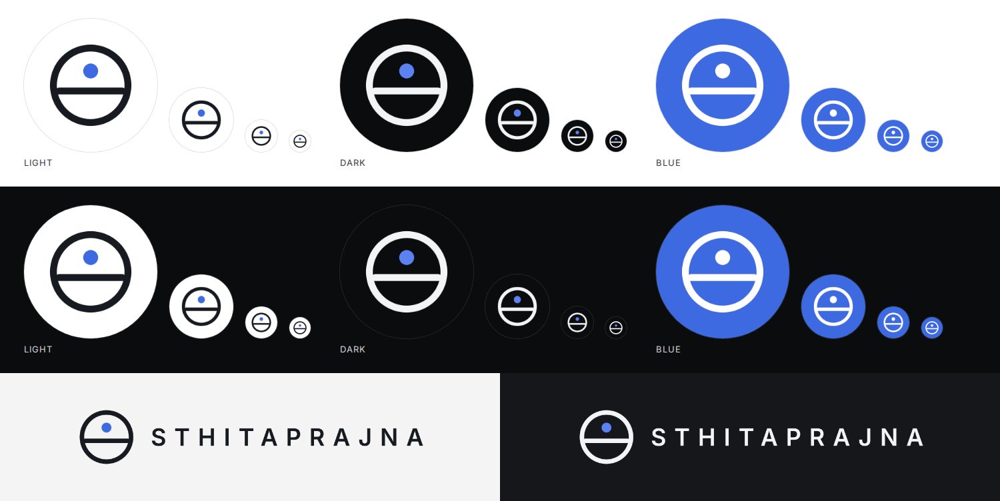

# Sthitaprajna brand files

The mark: a **circle** (the whole), a **level horizon** (equanimity) and a **steady point** above it (attention),
the same symbol as in the terminal's top bar. Colours are the terminal's own: ink `#171A20`, blue `#3E6AE1`
(dark-mode blue `#5B82F0`), dark background `#0B0C0E`.

## Profile photos (`profile/`)

Square images with a solid background. Discord, GitHub, WhatsApp, X, LinkedIn and Google crop them to a circle, and
the mark sits well inside that circle. Use the **1024** file; use **512** where a site limits file size.

| File | Best for |
|---|---|
| `sthitaprajna-profile-blue-1024.png` | **Recommended everywhere**: the most visible at small sizes (Discord bot and server icon, GitHub) |
| `sthitaprajna-profile-dark-1024.png` | Dark, minimal look (X, LinkedIn) |
| `sthitaprajna-profile-light-1024.png` | White backgrounds and documents |

Each also comes as a `.svg` (vector, for printing or resizing without blur).

## Where to upload (menus may move; look for the same words)
* **Discord bot:** Developer Portal → your app → **Bot** → Icon (also **General Information** → App Icon).
* **Discord server:** right-click the server → **Server Settings** → **Overview** → upload image.
* **GitHub:** **Settings** → **Public profile** → Profile picture → Edit → Upload.
* **WhatsApp / X / LinkedIn / Google:** profile → edit photo → choose the file.

## Logo and mark
| File | Use |
|---|---|
| `logo/sthitaprajna-logo-horizontal-on-light.png` | Horizontal logo, dark text, transparent background: light slides, documents, banners |
| `logo/sthitaprajna-logo-horizontal-on-dark.png` | The same with white text, for dark backgrounds |
| `sthitaprajna-mark.svg`, `sthitaprajna-mark-1024.png` | The mark alone, transparent, for light backgrounds |
| `sthitaprajna-mark-white.svg`, `sthitaprajna-mark-white-1024.png` | The mark alone, transparent, for dark backgrounds |

The wordmark is set in Inter SemiBold with wide letter spacing, as in the terminal.
